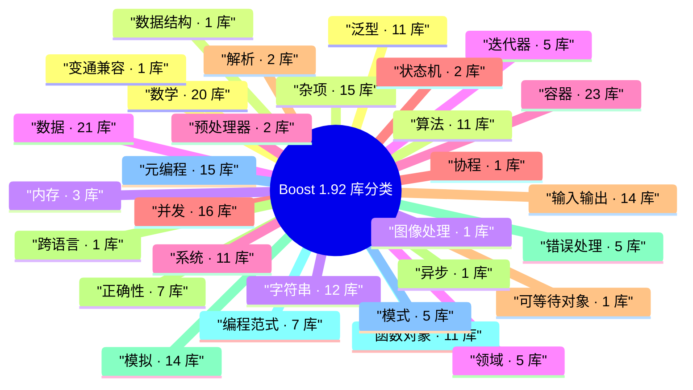
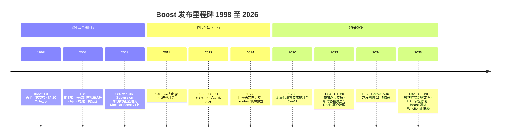
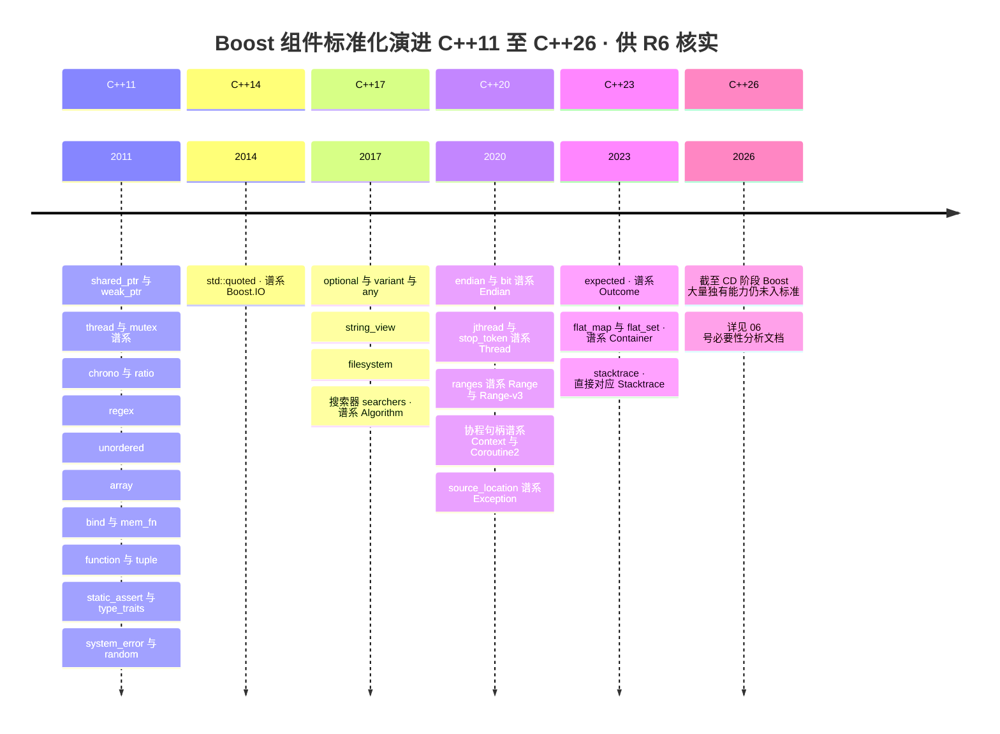

# Boost 组织架构与依赖详解

> **元数据**
> 生成日期：2026-11-14 ｜ 版本基线：**Boost 1.92.0（2026-11-14 冻结，1.93.0-beta1 只预告不统计）**
> 配套可视化：`html/boost_architecture.html`（单文件自包含，可离线交互）；本文 5 张 mermaid 图源文件与预渲染 SVG 位于 `html/_diagrams/`。

## 0. 来源清单与数据管线

### 0.1 来源清单（全部于 2026-11-14 实测核实）

| # | 来源 | 用途 | 核实结果 |
|---|---|---|---|
| 1 | https://www.boost.org/libraries/ （官网库列表页） | 30 个官方分类、逐库英文名/简介/分类/最低 C++ 标准/tier 状态（页面内嵌 JSON，174 条） | 200，内嵌 JSON 完整提取 |
| 2 | https://raw.githubusercontent.com/boostorg/boost/master/.gitmodules | superproject 子模块清单（库模块口径） | 200，159 个 libs/ 子模块 |
| 3 | https://raw.githubusercontent.com/boostorg/{仓库}/develop/meta/libraries.json （逐库） | 官方逐库元数据：description/category/cxxstd/maintainers | 158/159 命中；仅特殊模块 headers 无此文件 |
| 4 | https://raw.githubusercontent.com/boostorg/{仓库}/develop/build.jam 与 master 分支 build/Jamfile.v2 （逐库） | 官方构建文件：编译属性判定 + boost_dependencies 依赖常量 | 158/158 命中（131 个新式 build.jam + 27 个老式 build/Jamfile.v2） |
| 5 | https://raw.githubusercontent.com/microsoft/vcpkg/master/ports/boost-{名称}/vcpkg.json （逐端口） | 依赖交叉源（由 Boost 官方 generate-ports 脚本基于 boostdep（依赖分析工具）自动生成，端口版本恰为 1.92.0） | 157/158 命中；仅 int128 无端口（新模块收录滞后） |
| 6 | https://www.boost.org/releases/1.92.0/ 、/releases/1.87.0/ 、/releases/1.84.0/ | 发布亮点卡片（图④素材） | 200 |
| 7 | https://github.com/boostorg/boostdep （仓库根目录核实） | 确认官方依赖工具 boostdep 仓库**无预发布报告目录**（报告需编译生成） | 根目录仅 src/doc/build 等，无 report/ |
| 8 | 本工作区 docs/01_官方资源与最新版本.md | 版本发布日期谱系（其日期经 GitHub API 时间戳核实） | 1.92.0 = 2026-08-12 等 |

> 注：来源 5（vcpkg）为第三方仓库，但其 boost 端口由 Boost 官方脚本自动生成、逐项核对与来源 4 的官方依赖常量一致（如 boost-utility 端口依赖与 utility 库 build.jam 常量完全吻合），故作为老式 Jamfile 库的依赖补充源使用，并逐行标注依据。

### 0.2 实际数据管线说明

**实际采用路线：GitHub API / raw.githubusercontent（DR-003 主路线）。** boostdep 编译本会话未执行（按任务约定）。具体管线：

1. **模块口径**：从 boostorg/boost superproject 的 `.gitmodules` 提取 libs/ 下 159 个 git 子模块 = **158 个库模块** + 1 个特殊模块（headers，仅头文件分发载体，不计入库表）。
2. **库条目口径**：官网列表页内嵌 JSON 共 174 条 = 157 个顶级库条目 + 17 个嵌套子库条目（如 algorithm/string、utility/operators，官网曾按子库单列）；superproject 比官网多出 **int128**（官网列表页暂缺，经 meta/libraries.json 与 build.jam 确认为真实库模块）。
3. **依赖数据**：优先解析各库 **build.jam / build/Jamfile.v2 中的官方 boost_dependencies 常量**（即 b2（Boost 构建工具）构建的真实直接依赖）；老式 Jamfile 无常量块的 27 个库，用 vcpkg（微软系 C++ 包管理器）端口依赖（官方 boostdep 派生）补齐；两者并存时取并集。asio 特殊处理：仅取其主变体 boost_deps_core 依赖（context/date_time 属 deadline_timer 与 spawn 组件变体，单独标注）。
4. **未核实项**：仅 **int128** 的直接依赖未核实（其 build.jam 为模板残留、constant 未定义，且 vcpkg 无端口）；config 经核实确无直接依赖。
5. 图表：mermaid 5 张（图②含 3 个子图）全部经 mermaid-cli（mmdc 12.2.0）校验渲染通过；HTML 内嵌渲染后 SVG，无任何 CDN/外链。

---

## 1. 双视角：用户分类视角 vs superproject module 视角

Boost 的"组织架构"有两个同样权威、但粒度不同的观察口径：

| 维度 | 用户分类视角（官网 30 分类） | superproject module 视角（git 子模块） |
|---|---|---|
| 数据源 | boost.org 库列表页的分类标签（30 个分类，一库可属多分类） | boostorg/boost 超级项目的 `.gitmodules`（159 个子模块） |
| 单位 | "库条目"（174 条，含 17 条嵌套子库条目） | "模块" = 一个 git 仓库/子模块（158 个库模块） |
| 粒度差异 | algorithm/string、utility/operators 等子库在用户视角单列 | 它们只是 algorithm、utility 模块内的子目录，不是独立模块 |
| 反向差异 | 官网列表页暂缺 int128 条目 | int128 是真实存在的库模块（meta/libraries.json 与 build.jam 齐全） |
| 用途 | 按用途找库（学习/选型） | 发行、CI、依赖管理与版本发布（每个模块独立打 tag） |
| 本文档处理 | 总表"分类"列 + 图①/图② | 总表行 = 158 个库模块；17 条子库条目归入第 6 节附表 |

**核心结论**：两视角合计覆盖面一致（158 个库模块 ≈ 157 个官网顶级库条目 + int128）；差异仅是 17 条子库条目的归并与 int128 的列表页缺漏。

## 2. 总体架构速览

- **规模**：158 个库模块，其中需编译库 33 个、仅头文件库 125 个（含 config 等基础设施）。约 4/5 的库仅靠头文件即可使用。
- **30 个分类**：见 4.1 表与图①。分类标签可多重（如 Asio 同时属并发与输入输出），故分类计数之和大于 158。
- **依赖形态**：星型枢纽结构——config 被 156/158 个库直接依赖（除 config 自身与 int128），core/assert/type_traits/throw_exception 构成第二层枢纽（详见第 5 节与图③）。
- **语言标准**：官网标注最低标准从 C++03 到 C++20（cobalt），其中要求 C++11 及以上的库已占多数；1.73.0 起 Boost 全体最低要求为 C++11。

### 2.1 需编译的 33 个库（截至 1.92.0，依据各库 build.jam/Jamfile.v2 实测）

math, python, log, exception, thread, timer, regex, random, serialization, test, date_time, graph, filesystem, iostreams, graph_parallel, program_options, wave, mpi, atomic, chrono, coroutine, locale, context, type_erasure, fiber, process, stacktrace, contract, nowide, json, url, cobalt, charconv

> 值得注意的演进：**container 在 1.92.0 已无编译组件**（其 src/ 下的 global_resource.cpp 等编译源已移除，build.jam 的 alias 为空源列表，现为仅头文件库）；system 自 1.77 起同样转为仅头文件用法。

## 3. 架构图（mermaid 5 张）

> 以下 7 个代码块对应 5 张图（图②按主题域拆为 3 个子图）；源文件与预渲染 SVG 同存于 `html/_diagrams/`（d1_categories、d2a/d2b/d2c_theme、d3_hubs、d4_timeline、d5_standards）。

### 图① 30 官方分类 mindmap（节点为 分类 · 该分类库数）

### 图② 分类 → 代表库树（按主题域 3 张子图；每分类列 4 个代表库，全量见第 4 节总表）

**主题域 A · 语言与元编程基础（9 分类）**

**主题域 B · 数据、容器与算法（9 分类）**

```mermaid
flowchart TB
  ROOT["主题域 B · 数据、容器与算法"]
  subgraph S0 ["容器 · 23 库"]
    S0L0["unordered"]
    S0L1["container"]
    S0L2["variant2"]
    S0L3["json"]
    S0M["等 19 库"]
    S0L0 ~~~ S0L1 ~~~ S0L2 ~~~ S0L3 ~~~ S0M
  end
  ROOT --- S0
  subgraph S1 ["数据 · 21 库"]
    S1L0["uuid"]
    S1L1["geometry"]
    S1L2["container"]
    S1L3["variant2"]
    S1M["等 17 库"]
    S1L0 ~~~ S1L1 ~~~ S1L2 ~~~ S1L3 ~~~ S1M
  end
  ROOT --- S1
  subgraph S2 ["数据结构 · 1 库"]
    S2L0["dynamic_bitset"]
    S2L0
  end
  ROOT --- S2
  subgraph S3 ["内存 · 3 库"]
    S3L0["smart_ptr"]
    S3L1["pool"]
    S3L2["align"]
    S3L0 ~~~ S3L1 ~~~ S3L2
  end
  ROOT --- S3
  subgraph S4 ["字符串 · 12 库"]
    S4L0["regex"]
    S4L1["spirit"]
    S4L2["locale"]
    S4L3["lexical_cast"]
    S4M["等 8 库"]
    S4L0 ~~~ S4L1 ~~~ S4L2 ~~~ S4L3 ~~~ S4M
  end
  ROOT --- S4
  subgraph S5 ["解析 · 2 库"]
    S5L0["parser"]
    S5L1["spirit"]
    S5L0 ~~~ S5L1
  end
  ROOT --- S5
  subgraph S6 ["算法 · 11 库"]
    S6L0["geometry"]
    S6L1["algorithm"]
    S6L2["graph"]
    S6L3["graph_parallel"]
    S6M["等 7 库"]
    S6L0 ~~~ S6L1 ~~~ S6L2 ~~~ S6L3 ~~~ S6M
  end
  ROOT --- S6
  subgraph S7 ["数学 · 20 库"]
    S7L0["math"]
    S7L1["geometry"]
    S7L2["decimal"]
    S7L3["multi_array"]
    S7M["等 16 库"]
    S7L0 ~~~ S7L1 ~~~ S7L2 ~~~ S7L3 ~~~ S7M
  end
  ROOT --- S7
  subgraph S8 ["图像处理 · 1 库"]
    S8L0["gil"]
    S8L0
  end
  ROOT --- S8
  classDef catg fill:#e8f4e8,stroke:#4f744d,color:#1a1a2e,font-weight:bold;
  class S0,S1,S2,S3,S4,S5,S6,S7,S8 catg;
```

**主题域 C · 并发、系统与 IO（12 分类）**

### 图③ 依赖枢纽（graph LR，23 节点：16 个被依赖最多的枢纽库 + 7 个依赖别人最多的库；连线 = 直接依赖）

```mermaid
graph LR
  subgraph "被依赖最多的枢纽库"
    H_config["config · 被 156 库依赖"]
    H_core["core · 被 100 库依赖"]
    H_assert["assert · 被 96 库依赖"]
    H_type_traits["type_traits · 被 84 库依赖"]
    H_throw_exception["throw_exception · 被 69 库依赖"]
    H_mpl["mpl · 被 51 库依赖"]
    H_preprocessor["preprocessor · 被 47 库依赖"]
    H_utility["utility · 被 37 库依赖"]
    H_iterator["iterator · 被 36 库依赖"]
    H_smart_ptr["smart_ptr · 被 36 库依赖"]
    H_mp11["mp11 · 被 25 库依赖"]
    H_optional["optional · 被 24 库依赖"]
    H_predef["predef · 被 22 库依赖"]
    H_function["function · 被 22 库依赖"]
    H_range["range · 被 22 库依赖"]
    H_concept_check["concept_check · 被 21 库依赖"]
  end
  subgraph "依赖别人最多的库"
    P_graph["graph · 依赖 42 库"]
    P_log["log · 依赖 37 库"]
    P_geometry["geometry · 依赖 34 库"]
    P_spirit["spirit · 依赖 29 库"]
    P_compute["compute · 依赖 27 库"]
    P_graph_parallel["graph_parallel · 依赖 25 库"]
    P_thread["thread · 依赖 24 库"]
  end
  P_graph --> H_assert
  P_graph --> H_concept_check
  P_graph --> H_config
  P_graph --> H_core
  P_graph --> H_function
  P_graph --> H_iterator
  P_graph --> H_mpl
  P_graph --> H_optional
  P_graph --> H_preprocessor
  P_graph --> H_range
  P_graph --> H_smart_ptr
  P_graph --> H_throw_exception
  P_graph --> H_type_traits
  P_graph --> H_utility
  P_log --> H_assert
  P_log --> H_config
  P_log --> H_core
  P_log --> H_iterator
  P_log --> H_mpl
  P_log --> H_optional
  P_log --> H_predef
  P_log --> H_preprocessor
  P_log --> H_range
  P_log --> H_smart_ptr
  P_log --> H_throw_exception
  P_log --> H_type_traits
  P_log --> H_utility
  P_geometry --> H_assert
  P_geometry --> H_concept_check
  P_geometry --> H_config
  P_geometry --> H_core
  P_geometry --> H_iterator
  P_geometry --> H_mpl
  P_geometry --> H_predef
  P_geometry --> H_range
  P_geometry --> H_throw_exception
  P_spirit --> H_assert
  P_spirit --> H_config
  P_spirit --> H_core
  P_spirit --> H_function
  P_spirit --> H_iterator
  P_spirit --> H_mpl
  P_spirit --> H_optional
  P_spirit --> H_preprocessor
  P_spirit --> H_range
  P_spirit --> H_smart_ptr
  P_spirit --> H_throw_exception
  P_spirit --> H_type_traits
  P_spirit --> H_utility
  P_compute --> H_assert
  P_compute --> H_config
  P_compute --> H_core
  P_compute --> H_function
  P_compute --> H_iterator
  P_compute --> H_mpl
  P_compute --> H_optional
  P_compute --> H_preprocessor
  P_compute --> H_range
  P_compute --> H_smart_ptr
  P_compute --> H_throw_exception
  P_compute --> H_type_traits
  P_compute --> H_utility
  P_graph_parallel --> H_assert
  P_graph_parallel --> H_concept_check
  P_graph_parallel --> H_config
  P_graph_parallel --> H_core
  P_graph_parallel --> H_function
  P_graph_parallel --> H_iterator
  P_graph_parallel --> H_mpl
  P_graph_parallel --> H_optional
  P_graph_parallel --> H_smart_ptr
  P_graph_parallel --> H_type_traits
  P_thread --> H_assert
  P_thread --> H_concept_check
  P_thread --> H_config
  P_thread --> H_core
  P_thread --> H_function
  P_thread --> H_optional
  P_thread --> H_predef
  P_thread --> H_preprocessor
  P_thread --> H_smart_ptr
  P_thread --> H_throw_exception
  P_thread --> H_type_traits
  P_thread --> H_utility
  classDef hub fill:#f9d3e0,stroke:#b3477d,color:#1a1a2e;
  classDef pro fill:#d3e2f9,stroke:#476fb3,color:#1a1a2e;
  class H_config,H_core,H_assert,H_type_traits,H_throw_exception,H_mpl,H_preprocessor,H_utility,H_iterator,H_smart_ptr,H_mp11,H_optional,H_predef,H_function,H_range,H_concept_check hub;
  class P_graph,P_log,P_geometry,P_spirit,P_compute,P_graph_parallel,P_thread pro;
```

### 图④ 发布时间线（1.0 → 1.92 里程碑）

### 图⑤ 标准演进时间线（C++11 → C++26，Boost 组件合入标准对照；供 R6 细化核实）

## 4. 158 库总表（每库一行）

> 列说明：**属性**=仅头文件库/需编译（据各库 build.jam 实测）；**直接依赖**=官方 build_dependencies 常量与 vcpkg 端口（官方 boostdep 派生）并集，仅列直接依赖、不含传递依赖；行序按三大主题域与官网分类编排。
> 状态徽标：旗舰 = 官网 tier: flagship；已弃用 = 官网 tier: deprecated（被标准库取代或不再推荐，仍随版发布）。

| 库名（不译） | 一行中文简介 | 官网分类 | 属性 | 直接依赖 |
|---|---|---|---|---|
| `assert` | 可定制断言宏 | 正确性、错误处理 | 仅头文件库 | config |
| `concept_check` | 泛型编程概念（concept）检查工具 | 正确性、泛型 | 仅头文件库 | config, preprocessor, type_traits |
| `contract` | 契约式编程（类不变量、前置/后置条件） | 正确性 | 需编译 | any, assert, config, core, exception, function, function_types, mpl, optional, preprocessor, smart_ptr, static_assert, thread, type_traits, typeof, utility |
| `static_assert` | 编译期静态断言（已并入 Boost.Config） | 正确性、泛型、元编程 | 仅头文件库 | config |
| `test` | 单元测试框架与程序执行监控 | 正确性 | 需编译 | algorithm, assert, bind, config, core, detail, exception, function, io, iterator, mpl, numeric/conversion, optional, preprocessor, smart_ptr, type_traits, utility |
| `compat` | 后续标准组件的 C++11 实现补丁（span/string_view 等） | 模拟、编程范式 | 仅头文件库 | assert, config, throw_exception |
| `describe` | C++14 反射库（枚举/结构体成员描述宏） | 模拟、元编程 | 仅头文件库 | config, mp11 |
| `move` | C++03/C++11 兼容的移动语义与 emplace 辅助 | 模拟 | 仅头文件库 | config |
| `openmethod` | 类外开放多态方法（单/多重分派） | 模拟、编程范式 | 仅头文件库 | assert, config, core, dynamic_bitset, mp11, preprocessor, smart_ptr |
| `parameter` | 按名称传参的函数参数框架 | 模拟、编程范式 | 仅头文件库 | config, core, function, fusion, mp11, mpl, optional, preprocessor, type_traits, utility |
| `parameter_python` | Parameter 库的 Python 绑定 | 模拟、编程范式 | 仅头文件库 | config, mpl, parameter, preprocessor, python |
| `scope` | 作用域守卫集合与 unique_resource 封装 | 模拟、模式 | 仅头文件库 | assert, config, core, type_traits |
| `scope_exit` | 作用域退出时执行任意代码（BOOST_SCOPE_EXIT） | 模拟 | 仅头文件库 | config, function, preprocessor, type_traits, typeof |
| `throw_exception` | Boost 库统一异常抛出基础设施 | 模拟、错误处理 | 仅头文件库 | assert, config |
| `type_index` | 运行期/编译期可复制的类型信息 | 模拟 | 仅头文件库 | config, container_hash, throw_exception |
| `typeof` | typeof 运算符模拟（C++11 前的 decltype 替代） | 模拟 | 仅头文件库 | config |
| `bind` | 函数与成员指针参数绑定（std::bind 谱系源头） | 函数对象 | 仅头文件库 | config, core |
| `container_hash` | STL 兼容的可扩展哈希函数对象 | 函数对象 | 仅头文件库 | config, describe, mp11 |
| `function` | 多态函数对象包装（回调） | 函数对象、编程范式 | 仅头文件库 | assert, bind, config, core, throw_exception |
| `functional` | 函数对象包装器家族聚合模块（Function 系头文件的模块载体） | 函数对象 | 仅头文件库 | config, core, function, function_types, mpl, preprocessor, type_traits, typeof, utility |
| `hash2` | 可扩展哈希框架 | 函数对象 | 仅头文件库 | assert, config, container_hash, describe, mp11 |
| `lambda` | 调用点定义匿名函数对象（旧式 Lambda，已被 Phoenix 取代） | 函数对象 | 仅头文件库 | bind, config, core, detail, iterator, mpl, preprocessor, tuple, type_traits, utility |
| `lambda2` | 极简 C++14 Lambda 表达式库 | 函数对象 | 仅头文件库 | config |
| `local_function` | 在函数内部局部定义函数 | 函数对象 | 仅头文件库 | config, mpl, preprocessor, scope_exit, type_traits, typeof, utility |
| `phoenix` | 调用点匿名函数对象（Lambda 的现代继任者） | 函数对象 | 仅头文件库 | assert, bind, config, core, function, fusion, mpl, predef, preprocessor, proto, range, smart_ptr, type_traits, utility |
| `signals2` | 受管信号/槽回调（线程安全第 2 版） | 函数对象、模式 | 仅头文件库 | assert, bind, config, core, function, iterator, move, mpl, optional, parameter, preprocessor, smart_ptr, throw_exception, tuple, type_traits, variant |
| `function_types` | 函数/函数指针/成员指针类型的分类、分解与合成 | 泛型、元编程 | 仅头文件库 | config, core, detail, mpl, preprocessor, type_traits |
| `qvm` | 四元数/向量/矩阵通用库 | 泛型、数学、算法 | 仅头文件库 | config |
| `stl_interfaces` | 定义迭代器/视图/容器的 CRTP 基类模板（C++14+） | 泛型 | 仅头文件库 | assert, config, type_traits |
| `tti` | 类型特征内省（Type Traits Introspection） | 泛型、元编程 | 仅头文件库 | config, function_types, mpl, preprocessor, type_traits |
| `type_traits` | 类型基本属性模板（类型特征 traits） | 泛型、元编程 | 仅头文件库 | config |
| `yap` | 表达式模板库（C++14+，Proto 的轻量替代） | 泛型、元编程 | 仅头文件库 | config, hana, preprocessor, type_index |
| `iterator` | 迭代器概念体系与迭代器构建框架（含适配器） | 迭代器 | 仅头文件库 | assert, concept_check, config, core, detail, fusion, mp11, mpl, optional, type_traits, utility |
| `tokenizer` | 字符串分词器 | 迭代器、字符串 | 仅头文件库 | assert, config, core, iterator, throw_exception, type_traits |
| `callable_traits` | 可调用类型的编译期内省与操纵（FunctionTypes 精神续作） | 元编程 | 仅头文件库 | config |
| `hana` | 现代 C++ 异构元编程库（C++14） | 元编程 | 仅头文件库 | config, core, fusion, mpl, tuple |
| `hof` | 高阶函数库（Higher-Order Functions） | 元编程、函数对象 | 仅头文件库 | config |
| `metaparse` | 编译期解析器生成库（嵌入式 DSL） | 元编程 | 仅头文件库 | config, mpl, predef, preprocessor, type_traits |
| `mp11` | C++11 元编程库（MPL 的现代继任） | 元编程 | 仅头文件库 | config |
| `mpl` | 通用模板元编程框架（编译期算法/序列/元函数） | 元编程 | 仅头文件库 | config, core, predef, preprocessor, type_traits, utility |
| `proto` | 表达式模板库与嵌入式 DSL 编译器构建工具 | 元编程 | 仅头文件库 | config, core, fusion, mpl, preprocessor, range, type_traits, typeof, utility |
| `preprocessor` | 预处理器元编程工具（重复与递归宏） | 预处理器 | 仅头文件库 | config |
| `vmd` | 可变宏数据（Variadic Macro Data，预处理器扩展） | 预处理器 | 仅头文件库 | config, preprocessor |
| `config` | 编译器/平台特性检测与配置宏（Boost 内部基础设施，不面向库用户） | 变通兼容 | 仅头文件库 | —（无直接依赖，自身为最底层） |
| `algorithm` | 通用算法集合（含 Boyer-Moore 等搜索与 minmax） | 算法 | 仅头文件库 | array, assert, bind, concept_check, config, core, exception, function, iterator, mpl, range, regex, throw_exception, tuple, type_traits, unordered |
| `foreach` | BOOST_FOREACH 序列遍历宏 | 算法、模拟 | 仅头文件库 | config, core, iterator, mpl, range, type_traits |
| `geometry` | 几何算法、图元与空间索引 | 算法、数据、数学 | 仅头文件库 | algorithm, any, array, assert, concept_check, config, container, core, crc, endian, function_types, fusion, graph, integer, iterator, lexical_cast, math, mpl, multiprecision, numeric/conversion, polygon, predef, program_options, qvm, range, rational, serialization, static_assert, thread, throw_exception, tokenizer, tuple, variant, variant2 |
| `gil` | 通用图像库（C++14） | 算法、容器、泛型、图像处理、迭代器 | 仅头文件库 | assert, concept_check, config, container_hash, core, integer, iterator, mp11, preprocessor, type_traits, variant2 |
| `graph` | 图结构与算法（BGL，STL 风格泛型接口） | 算法、容器、迭代器 | 需编译 | algorithm, any, array, assert, bimap, concept_check, config, container_hash, conversion, core, detail, foreach, function, integer, iterator, lexical_cast, math, move, mpl, multi_index, multiprecision, numeric/conversion, optional, parameter, preprocessor, property_map, property_tree, random, range, regex, serialization, smart_ptr, spirit, static_assert, throw_exception, tti, tuple, type_traits, typeof, unordered, utility, xpressive |
| `graph_parallel` | 并行图算法（PBGL，面向分布式内存） | 算法、容器、迭代器 | 需编译 | algorithm, assert, concept_check, config, container_hash, core, detail, dynamic_bitset, filesystem, foreach, function, graph, iterator, lexical_cast, mpi, mpl, optional, property_map, property_map_parallel, random, serialization, smart_ptr, tuple, type_traits, variant |
| `histogram` | 快速多维直方图 | 算法、数据、数学 | 仅头文件库 | config, core, math, mp11, serialization, throw_exception, variant2 |
| `polygon` | 平面多边形布尔运算、裁剪与 Voronoi 图 | 算法、数据、数学 | 仅头文件库 | config |
| `range` | 基于新迭代器概念的泛型算法基础设施 | 算法 | 仅头文件库 | array, assert, concept_check, config, container_hash, conversion, core, detail, iterator, mpl, optional, preprocessor, regex, tuple, type_traits, utility |
| `sort` | 高性能模板排序函数 | 算法 | 仅头文件库 | config, core, range, type_traits |
| `array` | 定长数组容器（STL 兼容） | 容器 | 仅头文件库 | assert, config, throw_exception |
| `bimap` | 双向映射容器（两方均可作键） | 容器、数据 | 仅头文件库 | concept_check, config, container_hash, core, iterator, lambda, mp11, mpl, multi_index, preprocessor, throw_exception, type_traits, utility |
| `bloom` | 布隆过滤器 | 容器 | 仅头文件库 | assert, config, container_hash, core, throw_exception, type_traits |
| `circular_buffer` | 环形缓冲区（STL 兼容） | 容器 | 仅头文件库 | assert, concept_check, config, core, move, throw_exception, type_traits |
| `container` | 标准库容器扩展（flat_map、stable_vector、devector 等） | 容器、数据 | 仅头文件库 | assert, config, intrusive, move |
| `icl` | 区间容器库（区间集合/映射与值聚合） | 容器、数据 | 仅头文件库 | assert, concept_check, config, container, core, date_time, detail, iterator, move, mpl, range, rational, static_assert, type_traits, utility |
| `intrusive` | 侵入式容器与算法 | 容器 | 仅头文件库 | assert, config, move |
| `json` | JSON 解析、序列化与 DOM（C++11） | 容器、数据、输入输出 | 需编译 | assert, charconv, config, container, container_hash, core, describe, endian, mp11, system, throw_exception |
| `multi_array` | 通用 N 维数组概念与多维数组容器 | 容器、数学 | 仅头文件库 | array, assert, concept_check, config, core, functional, iterator, mpl, type_traits |
| `multi_index` | 多索引容器（同一容器维持多套排序与访问语义） | 容器、数据 | 仅头文件库 | assert, bind, config, container_hash, core, integer, mp11, preprocessor, smart_ptr, throw_exception, tuple, type_traits, utility |
| `poly_collection` | 多态对象高速容器（按类型分段存储） | 容器 | 仅头文件库 | assert, config, container, core, iterator, mp11, mpl, type_erasure, type_traits |
| `property_map` | 键到值映射接口概念 | 容器、泛型 | 仅头文件库 | any, assert, concept_check, config, core, function, iterator, lexical_cast, mpl, smart_ptr, throw_exception, type_index, type_traits, utility |
| `property_map_parallel` | Property Map 并行扩展（配合 Parallel Graph） | 容器、泛型 | 仅头文件库 | assert, concept_check, config, function, mpi, mpl, multi_index, optional, property_map, serialization, smart_ptr, type_traits |
| `property_tree` | 属性树数据结构（配置存储，支持 JSON/INI/XML 等格式解析） | 容器、数据 | 仅头文件库 | any, assert, bind, config, core, iterator, mpl, multi_index, optional, range, serialization, throw_exception, type_traits |
| `ptr_container` | 指针容器（存储堆上多态对象） | 容器、数据 | 仅头文件库 | array, assert, circular_buffer, config, core, iterator, mpl, range, smart_ptr, type_traits, unordered, utility |
| `static_string` | 定容量动态长度字符串 | 容器、字符串 | 仅头文件库 | assert, config, container_hash, core, throw_exception, utility |
| `unordered` | 无序关联容器（hash 实现） | 容器 | 仅头文件库 | assert, config, container_hash, core, mp11, predef, throw_exception |
| `url` | URL 解析与处理（C++11） | 容器、数据、输入输出 | 需编译 | align, assert, config, core, mp11, optional, system, throw_exception, type_traits, variant2 |
| `variant` | 栈上可辨识联合（安全泛型容器） | 容器、数据 | 仅头文件库 | assert, config, container_hash, core, detail, integer, mpl, preprocessor, static_assert, throw_exception, type_index, type_traits, utility |
| `variant2` | std::variant 的 never-valueless 强保证实现 | 容器、数据 | 仅头文件库 | assert, config, mp11 |
| `any` | 类型安全的任意类型单值容器 | 数据 | 仅头文件库 | assert, config, throw_exception, type_index |
| `fusion` | 元组/异构容器与算法（编译期与运行期融合） | 数据、元编程 | 仅头文件库 | config, container_hash, core, function_types, mpl, preprocessor, tuple, type_traits, typeof, utility |
| `heap` | 优先队列数据结构家族 | 数据 | 仅头文件库 | assert, concept_check, config, core, intrusive, iterator, parameter, throw_exception, type_traits |
| `optional` | 可选值（nullable）值语义包装 | 数据 | 仅头文件库 | assert, config, core, throw_exception, type_traits |
| `pfr` | 用户定义类型的基础反射（无宏 Magic GET） | 数据、元编程 | 仅头文件库 | config |
| `tuple` | 元组与多返回值支持 | 数据 | 仅头文件库 | config, core, type_traits |
| `type_erasure` | 基于概念的运行期多态（鸭子类型） | 数据 | 需编译 | assert, config, core, fusion, iterator, mp11, mpl, preprocessor, smart_ptr, thread, throw_exception, type_traits, typeof, vmd |
| `uuid` | 通用唯一标识符 UUID 生成与解析 | 数据、领域 | 仅头文件库 | assert, config, throw_exception, type_traits |
| `dynamic_bitset` | 运行期可变长位集 | 数据结构 | 仅头文件库 | assert, config, container_hash, core, throw_exception |
| `accumulators` | 增量计算与统计累加器框架 | 数学 | 仅头文件库 | array, assert, circular_buffer, concept_check, config, core, fusion, iterator, mpl, numeric/conversion, numeric/ublas, parameter, preprocessor, range, serialization, throw_exception, tuple, type_traits, typeof |
| `decimal` | IEEE754 十进制浮点数实现 | 数学 | 仅头文件库 | config |
| `int128` | 可移植高性能 128 位整数 | 数学 | 仅头文件库 | 未核实 |
| `integer` | 整数类型选择与 cstdint 安全封装 | 数学 | 仅头文件库 | assert, config, core, throw_exception, type_traits |
| `math` | 数学专题集：浮点工具、数学常数、统计分布、特殊函数、求根、积分与插值等 | 数学 | 需编译 | assert, concept_check, config, core, integer, lexical_cast, predef, random, throw_exception |
| `multiprecision` | 扩展精度算术（浮点/整数/有理数，支持任意精度） | 数学 | 仅头文件库 | assert, config, core, integer, lexical_cast, math, predef, random, throw_exception |
| `numeric/conversion` | 基于策略的数值类型安全转换 | 数学、杂项 | 仅头文件库 | config, conversion, core, mpl, preprocessor, throw_exception, type_traits |
| `numeric/interval` | 区间算术（数学区间扩展） | 数学 | 仅头文件库 | config, detail, logic, type_traits |
| `numeric/odeint` | 常微分方程数值求解 | 数学 | 仅头文件库 | assert, compute, config, core, fusion, iterator, math, mpi, mpl, multi_array, numeric/ublas, preprocessor, range, throw_exception, type_traits, units, utility |
| `numeric/ublas` | 张量/矩阵/向量与基础线性代数（稠密/打包/稀疏存储） | 数学 | 仅头文件库 | compute, concept_check, config, core, iterator, mpl, numeric/interval, range, serialization, smart_ptr, type_traits, typeof |
| `random` | 完整的随机数生成系统（生成器与分布） | 数学 | 需编译 | assert, config, core, dynamic_bitset, integer, io, system, throw_exception, type_traits, utility |
| `ratio` | 编译期分数运算（C++11） | 数学 | 仅头文件库 | config |
| `rational` | 有理数类 | 数学 | 仅头文件库 | assert, config, core, integer, throw_exception, type_traits, utility |
| `safe_numerics` | 保证正确的整数运算（溢出检查） | 数学、正确性 | 仅头文件库 | concept_check, config, core, integer, logic, mp11 |
| `align` | 内存对齐函数、分配器与特征 | 内存 | 仅头文件库 | assert, config, core |
| `pool` | 内存池管理 | 内存 | 仅头文件库 | assert, config, integer, throw_exception, type_traits, winapi |
| `smart_ptr` | 智能指针家族（shared_ptr/weak_ptr/intrusive_ptr 等） | 内存 | 仅头文件库 | assert, config, core, throw_exception |
| `parser` | 解析器组合子库（C++17） | 解析 | 仅头文件库 | assert, charconv, config, hana, type_index |
| `spirit` | 直接以 EBNF 文法内嵌 C++ 的解析器/生成器框架 | 解析、字符串 | 仅头文件库 | array, assert, config, core, endian, function, function_types, fusion, integer, io, iterator, move, mpl, optional, phoenix, pool, preprocessor, proto, range, regex, smart_ptr, static_assert, thread, throw_exception, type_traits, typeof, unordered, utility, variant |
| `locale` | 本地化与 Unicode 文本处理 | 字符串 | 需编译 | assert, charconv, config, core, iterator, predef, thread |
| `regex` | 正则表达式库 | 字符串 | 需编译 | assert, concept_check, config, core, predef, throw_exception, type_traits |
| `wave` | 标准 C99/C++ 预处理器实现（迭代器接口） | 字符串 | 需编译 | assert, concept_check, config, core, filesystem, format, iterator, lexical_cast, mpl, multi_index, optional, pool, preprocessor, serialization, smart_ptr, spirit, static_assert, throw_exception, type_traits |
| `xpressive` | 字符串或表达式模板两种写法的正则，可递归引用（具上下文无关文法能力） | 字符串 | 仅头文件库 | assert, config, conversion, core, exception, fusion, integer, iterator, lexical_cast, mpl, numeric/conversion, optional, preprocessor, proto, range, smart_ptr, spirit, throw_exception, type_traits, typeof, utility |
| `asio` | 跨平台网络与底层 I/O（套接字、定时器、名字解析、串口等，proactor 模型） | 并发、输入输出 | 仅头文件库 | align, assert, config, system, throw_exception |
| `atomic` | C++11 风格原子操作类型 | 并发 | 需编译 | align, assert, config, predef, preprocessor, type_traits, winapi |
| `beast` | 仅用 C++11 与 Boost.Asio 实现的 HTTP/WebSocket 库 | 并发、输入输出 | 仅头文件库 | asio, assert, bind, config, container, container_hash, core, endian, intrusive, logic, mp11, optional, smart_ptr, static_string, system, throw_exception, type_index, type_traits, winapi |
| `cobalt` | C++20 协程基础算法与类型 | 并发、协程、可等待对象、异步 | 需编译 | asio, callable_traits, circular_buffer, config, container, context, core, endian, intrusive, mp11, preprocessor, smart_ptr, static_string, system, throw_exception, variant2 |
| `compute` | 并行/GPU 计算库（OpenCL） | 并发 | 仅头文件库 | algorithm, array, assert, atomic, chrono, config, core, filesystem, function, function_types, fusion, iterator, lexical_cast, mpl, optional, preprocessor, property_tree, proto, range, smart_ptr, thread, throw_exception, tuple, type_traits, typeof, utility, uuid |
| `context` | 执行上下文切换原语（ucontext/fiber） | 并发、系统 | 需编译 | assert, config, core, mp11, pool, predef, smart_ptr |
| `coroutine` | 协程（栈式，旧版） | 并发 | 需编译 | assert, config, context, core, exception, move, system, throw_exception, type_traits, utility |
| `coroutine2` | 协程（栈式，基于 Context 的现代实现） | 并发 | 仅头文件库 | assert, config, context |
| `fiber` | 用户态纤程（Fiber）与通道 | 并发、系统 | 需编译 | algorithm, assert, config, context, core, filesystem, format, intrusive, predef, smart_ptr |
| `interprocess` | 进程间通信：共享内存、内存映射文件与进程共享同步原语 | 并发 | 仅头文件库 | assert, config, container, intrusive, move, winapi |
| `lockfree` | 无锁数据结构（队列/栈/哈希表） | 并发 | 仅头文件库 | align, assert, atomic, config, core, parameter, predef, throw_exception, type_traits |
| `mpi` | MPI 消息传递接口封装（分布式内存并行） | 并发 | 需编译 | assert, config, core, foreach, function, graph, integer, iterator, lexical_cast, mpl, optional, serialization, smart_ptr, throw_exception, type_traits, utility |
| `mqtt5` | 基于 Boost.Asio 的 MQTT5 客户端 | 并发、输入输出 | 仅头文件库 | asio, assert, config, container, core, endian, random, range, smart_ptr, system, type_traits |
| `mysql` | 基于 Boost.Asio 的 MySQL 异步客户端 | 并发、输入输出 | 仅头文件库 | asio, assert, charconv, compat, config, container, core, describe, endian, intrusive, mp11, optional, pfr, system, throw_exception, variant2 |
| `redis` | 基于 Boost.Asio 的 Redis 异步客户端 | 并发、输入输出 | 仅头文件库 | asio, assert, config, core, mp11, system, throw_exception |
| `thread` | 可移植多线程库（对齐 C++11/14/17） | 并发、系统 | 需编译 | assert, atomic, bind, chrono, concept_check, config, container, container_hash, core, date_time, exception, function, io, move, optional, predef, preprocessor, smart_ptr, system, throw_exception, tuple, type_traits, utility, winapi |
| `chrono` | 时间工具（C++11 时钟/时长/时间点） | 领域、系统 | 需编译 | assert, config, core, integer, move, mpl, predef, ratio, system, throw_exception, type_traits, typeof, utility, winapi |
| `crc` | CRC 循环冗余校验计算对象与函数 | 领域 | 仅头文件库 | config |
| `date_time` | 日期时间处理（公历/本地时间/时区） | 领域、系统 | 需编译 | algorithm, assert, config, core, io, lexical_cast, numeric/conversion, range, smart_ptr, static_assert, throw_exception, tokenizer, type_traits, utility, winapi |
| `units` | 零开销量纲分析与单位/数量转换 | 领域 | 仅头文件库 | assert, config, core, integer, io, lambda, math, move, mpl, preprocessor, type_traits, typeof |
| `exception` | 异常对象携带任意数据与跨线程异常传输 | 错误处理、模拟 | 需编译 | assert, config, core, smart_ptr, throw_exception, tuple, type_traits |
| `leaf` | C++11 轻量错误处理库 | 错误处理 | 仅头文件库 | config |
| `python` | C++ 与 Python 双向绑定框架 | 跨语言 | 需编译 | align, bind, config, conversion, core, detail, foreach, function, graph, integer, iterator, lexical_cast, mpl, numeric/conversion, preprocessor, property_map, smart_ptr, static_assert, tuple, type_traits, utility |
| `assign` | 以常量或生成数据填充容器的便捷语法 | 输入输出 | 仅头文件库 | array, config, core, move, preprocessor, ptr_container, range, throw_exception, tuple, type_traits |
| `endian` | 字节序类型与转换函数 | 输入输出、数学、杂项 | 仅头文件库 | config |
| `format` | 类型安全的 printf 风格格式化 | 输入输出、字符串 | 仅头文件库 | assert, config, core, optional, smart_ptr, throw_exception, utility |
| `io` | 标准 I/O 库辅助工具（流状态保存器等） | 输入输出 | 仅头文件库 | config |
| `iostreams` | 流/流缓冲/IO 过滤器框架 | 输入输出、字符串 | 需编译 | assert, config, core, detail, function, integer, iterator, mpl, numeric/conversion, preprocessor, random, range, regex, smart_ptr, throw_exception, type_traits, utility |
| `program_options` | 命令行/配置文件/环境变量选项解析 | 输入输出、杂项 | 需编译 | any, bind, config, core, detail, function, iterator, lexical_cast, smart_ptr, static_assert, throw_exception, tokenizer, type_traits |
| `serialization` | 序列化框架（持久化与编组，版本化多格式） | 输入输出 | 需编译 | array, assert, config, core, detail, function, integer, io, iterator, move, mp11, mpl, optional, predef, preprocessor, smart_ptr, spirit, static_assert, throw_exception, type_traits, utility, variant, variant2 |
| `charconv` | charconv 的 C++11 实现（to_chars/from_chars） | 杂项、字符串 | 需编译 | assert, config, core |
| `conversion` | 多态 cast（polymorphic_downcast 等） | 杂项 | 仅头文件库 | assert, config, smart_ptr, throw_exception |
| `convert` | 可扩展可配置的类型转换框架 | 杂项、字符串 | 仅头文件库 | config, core, function_types, lexical_cast, math, mpl, optional, parameter, range, spirit, type_traits |
| `core` | 最小依赖的核心工具集（非空指针、地址获取、轻量设施） | 杂项 | 仅头文件库 | assert, config, throw_exception |
| `detail` | Boost 内部实现用仅头文件工具集 | 杂项 | 仅头文件库 | config, core, preprocessor, type_traits |
| `lexical_cast` | 字面文本与类型的通用转换（字符串与数值互转） | 杂项、字符串 | 仅头文件库 | config, container, core, throw_exception |
| `log` | 日志库（多接收端、多格式、过滤与多线程支持） | 杂项 | 需编译 | align, asio, assert, atomic, bind, config, core, date_time, exception, filesystem, function_types, fusion, interprocess, intrusive, io, iterator, move, mpl, optional, parameter, phoenix, predef, preprocessor, property_tree, proto, range, regex, smart_ptr, spirit, system, thread, throw_exception, type_index, type_traits, utility, winapi, xpressive |
| `logic` | 三态布尔类型 Tribool | 杂项 | 仅头文件库 | config, core |
| `predef` | 编译器/架构/操作系统/库版本号预定义宏 | 杂项 | 仅头文件库 | config |
| `timer` | 事件计时器与进度显示 | 杂项 | 需编译 | config, io, predef |
| `utility` | 通用工具集（base-from-member 惯用法、C++03 二进制字面量等） | 杂项、模式 | 仅头文件库 | assert, config, core, io, preprocessor, throw_exception, type_traits |
| `winapi` | Windows API 抽象薄层 | 杂项 | 仅头文件库 | config, predef |
| `flyweight` | 享元模式（管理大量高度冗余对象） | 模式 | 仅头文件库 | assert, config, container_hash, core, detail, interprocess, mpl, multi_index, parameter, preprocessor, smart_ptr, throw_exception, type_traits, unordered |
| `outcome` | 确定性失败处理（部分模拟轻量异常） | 模式、模拟、编程范式 | 仅头文件库 | assert, config, exception, system, throw_exception |
| `msm` | 高性能 UML2 有限状态机（Meta State Machine） | 状态机 | 仅头文件库 | any, assert, bind, circular_buffer, config, core, function, fusion, json, mp11, mpl, parameter, phoenix, preprocessor, proto, serialization, tuple, type_index, type_traits, typeof |
| `statechart` | 任意复杂有限状态机（可读可维护的 C++ 实现） | 状态机 | 仅头文件库 | assert, bind, config, conversion, core, detail, function, mpl, smart_ptr, thread, type_traits |
| `dll` | DLL/DSO 动态库便捷加载与符号访问 | 系统 | 仅头文件库 | assert, config, core, filesystem, predef, system, throw_exception, type_index, winapi |
| `filesystem` | 可移植文件系统操作（路径/文件/目录） | 系统 | 需编译 | assert, atomic, config, container_hash, core, detail, io, iterator, predef, scope, smart_ptr, system, type_traits, winapi |
| `nowide` | Windows 上带 UTF-8 API 的标准库函数 | 系统 | 需编译 | config, filesystem |
| `process` | 可移植进程创建与管理（v2） | 系统 | 需编译 | algorithm, asio, assert, config, core, filesystem, fusion, io, iterator, move, optional, system, throw_exception, tokenizer, type_index, type_traits, utility, winapi |
| `stacktrace` | 堆栈回溯的收集、存储与打印 | 系统、正确性 | 需编译 | assert, config, container_hash, core, predef, winapi |
| `system` | 可扩展的错误报告设施（error_code 与 system_error） | 系统、错误处理、编程范式 | 仅头文件库 | assert, compat, config, mp11, throw_exception, variant2, winapi |

## 5. 依赖枢纽分析

### 5.1 被依赖最多的库（入度 Top 20，统计口径 = 158 库的直接依赖并集）

| 排名 | 库名 | 被直接依赖次数 | 角色 |
|---|---|---|---|
| 1 | `config` | 156 | 最底层编译器/平台配置宏 |
| 2 | `core` | 100 | 核心轻量工具 |
| 3 | `assert` | 96 | 可定制断言宏 |
| 4 | `type_traits` | 84 | 类型特征 |
| 5 | `throw_exception` | 69 | 统一异常抛出 |
| 6 | `mpl` | 51 | 模板元编程框架 |
| 7 | `preprocessor` | 47 | 预处理器元编程 |
| 8 | `utility` | 37 | 通用工具集 |
| 9 | `iterator` | 36 | 迭代器构建设施 |
| 10 | `smart_ptr` | 36 | 智能指针 |
| 11 | `mp11` | 25 | C++11 元编程库 |
| 12 | `optional` | 24 | 可选值 |
| 13 | `predef` | 22 | 预定义宏库 |
| 14 | `function` | 22 | 多态函数包装 |
| 15 | `range` | 22 | 范围抽象 |
| 16 | `concept_check` | 21 | 概念检查 |
| 17 | `container_hash` | 20 | 可扩展哈希 |
| 18 | `integer` | 19 | 整数类型选择 |
| 19 | `tuple` | 17 | 元组 |
| 20 | `detail` | 17 | 内部工具 |

（config 156 = 除自身与 int128 外全部库直接依赖；int128 依赖未核实未计入其入度分母之外——即 158 库中 156 个库依赖 config。）

### 5.2 依赖别人最多的库（出度 Top 15）

| 排名 | 库名 | 直接依赖数 | 简注 |
|---|---|---|---|
| 1 | `graph` | 42 | BGL 算法域广，需容器/数学/序列化等 |
| 2 | `log` | 37 | 日志后端多样（含 asio syslog） |
| 3 | `geometry` | 34 | 几何算法覆盖面大 |
| 4 | `spirit` | 29 | 解析器框架依赖 Proto/Fusion 等 |
| 5 | `compute` | 27 | GPU 计算封装多后端 |
| 6 | `graph_parallel` | 25 | 并行图叠加 Graph 与 MPI |
| 7 | `thread` | 24 | 线程库覆盖同步/时间/容器等 |
| 8 | `serialization` | 23 | 多格式归档前端 |
| 9 | `python` | 21 | 绑定层复用工具面广 |
| 10 | `xpressive` | 21 | 正则+文法双引擎 |
| 11 | `msm` | 20 | 状态机复用 Fusion/Phoenix 等 |
| 12 | `wave` | 19 | 预处理器实现复用 Spirit 系 |
| 13 | `accumulators` | 19 | 统计累加器组合 |
| 14 | `beast` | 19 | HTTP/WS 全栈在 Asio 上 |
| 15 | `process` | 18 | 进程管理复用 Asio/System 等 |

### 5.3 解读

1. **四层星型结构**：最底层 config（零依赖）→ 第二层 assert/core/throw_exception/type_traits/preprocessor（只依赖 config 或近乎零依赖）→ 第三层 utility/iterator/smart_ptr/mp11/optional/range 等通用构件 → 最外层业务库（Asio/Beast/Graph/Log 等）。
2. **枢纽库即兼容层**：config、type_traits、assert 的大量"依赖"本质是编译器/标准兼容宏的引用；这也是 Boost 各库能横跨 C++11 至 C++23 的机制保障。1.87.0 官方亮点"六库削减 19 项依赖"、1.92.0"Beast 削减 Functional 依赖、Graph 削减 StaticAssert 依赖"正是对这一层的持续瘦身。
3. **重依赖库 = 集大成者**：graph（42 项）与 log（37 项）、geometry（34 项）依赖面最广，因其算法域需要容器/迭代器/数学/序列化等多面能力；它们的编译属性（需编译）与高依赖数使 bug 修复发布的影响面较大。
4. **无依赖库**：config（除自身外最底层）；依赖未核实：int128（见 0.2 节第 4 条）。

## 6. 附表：官网嵌套子库条目（17 条，父模块内子库）

> 这些条目在官网列表页单列（用户视角独立"库"），但在 superproject 中是父模块内的子目录/头文件组，不是独立 git 模块。

| 官网条目（slug） | 父模块 | 官网名称 | 中文简介 | tier |
|---|---|---|---|---|
| utility/call_traits | utility | Call Traits | 传参类型定义（call_traits） | 经典 |
| utility/compressed_pair | utility | Compressed Pair | 空成员优化的 pair | 已弃用 |
| utility/enable_if | utility | Enable If | SFINAE 条件启用模板（enable_if） | 已弃用 |
| functional/factory | functional | Functional/Factory | 工厂函数模板 | 核心 |
| functional/forward | functional | Functional/Forward | 转发函数模板 | 经典 |
| functional/overloaded_function | functional | Functional/Overloaded Function | 重载函数集合包装 | 经典 |
| utility/identity_type | utility | Identity Type | 宏内类型身份包装 | 已弃用 |
| utility/in_place_factories | utility | In Place Factory, Typed In Place Factory | 原位构造工厂 | 经典 |
| bind/mem_fn | bind | Member Function | 成员函数指针包装（mem_fn） | 已弃用 |
| algorithm/minmax | algorithm | Min-Max | 同时求最小与最大的 minmax 系列算法 | 经典 |
| utility/operators | utility | Operators | 算术运算符自动生成模板基类 | 已弃用 |
| bind/ref | bind | Ref | 引用包装（ref/cref） | 经典 |
| utility/result_of | utility | Result Of | 函数调用结果类型推导（旧版） | 基础设施 |
| algorithm/string | algorithm | String Algo | 字符串算法（trim/replace/split 等） | 核心 |
| utility/string_view | utility | String View | 只读字符串视图（旧版实现，后并入 Core 谱系） | 经典 |
| utility/swap | utility | Swap | 可定制 swap 实现（后并入 Core 谱系） | 经典 |
| utility/value_initialized | utility | Value Initialized | 值初始化包装 | 经典 |

## 7. 附表：30 分类 × 库数（旗舰库示例）

| 分类（官网 30 分类） | 库数 | 旗舰库（tier: flagship） |
|---|---|---|
| 数学 | 20 | `math`、`geometry`、`decimal` |
| 算法 | 11 | `geometry` |
| 内存 | 3 | — |
| 数据 | 21 | `uuid`、`geometry`、`container`、`variant2`、`json`、`pfr`、`url` |
| 容器 | 23 | `unordered`、`container`、`variant2`、`json`、`url`、`bloom` |
| 并发 | 16 | `asio`、`beast`、`mysql`、`redis`、`cobalt`、`mqtt5` |
| 输入输出 | 14 | `asio`、`beast`、`json`、`url`、`mysql`、`redis`、`mqtt5` |
| 正确性 | 7 | `test` |
| 错误处理 | 5 | — |
| 函数对象 | 11 | `hash2` |
| 元编程 | 15 | `pfr`、`describe` |
| 泛型 | 11 | — |
| 杂项 | 15 | — |
| 字符串 | 12 | `regex` |
| 领域 | 5 | `uuid` |
| 系统 | 11 | — |
| 协程 | 1 | `cobalt` |
| 可等待对象 | 1 | `cobalt` |
| 异步 | 1 | `cobalt` |
| 模拟 | 14 | `describe`、`openmethod` |
| 编程范式 | 7 | `openmethod` |
| 模式 | 5 | — |
| 变通兼容 | 1 | — |
| 数据结构 | 1 | — |
| 图像处理 | 1 | — |
| 迭代器 | 5 | — |
| 预处理器 | 2 | — |
| 状态机 | 2 | — |
| 解析 | 2 | `parser` |
| 跨语言 | 1 | — |

---

> 图表校验记录：7 个 mermaid 源文件均以 mermaid-cli 12.2.0 渲染通过（2026-11-14），SVG 已内嵌于 `html/boost_architecture.html`。
